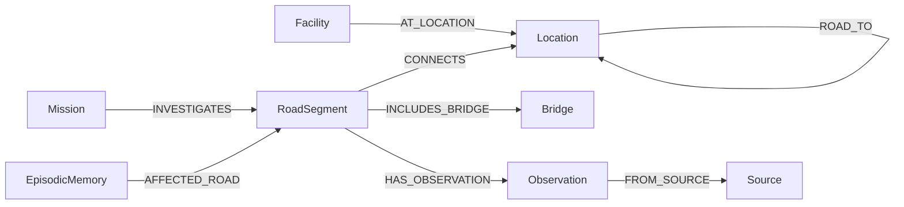

# Badi (बाढी) — Flood Response Route Intelligence

> Autonomous flood triage agent for Nepal mountain roads, powered by FalkorDB.
>
> Built for the **WeMakeDevs × FalkorDB "Graph Hacks: Context for AI Agents" Hackathon**.
>
> - **Track 01**: Agents That Act on Connected Data
> - **Track 02**: Agent Memory and Coordination

---

## The Problem and The Solution

### The Problem

During post-monsoon floods in countries like Nepal, mountain roads wash out quickly. Landslides destroy bridges and cut off entire villages from district hospitals.

Relief teams face three critical challenges:

1. **You cannot assume an unobserved road is safe.** A path to a hospital is safe only when scouts physically verify every segment.
2. **Standard databases cannot easily find isolated villages.** When a main road fails, SQL tables cannot quickly calculate which villages lost their only lifeline.
3. **Decisions need cross-session memory.** Field scout reports, road closures, and mission choices must be saved so AI agents coordinate without losing context.

### The Solution: Why FalkorDB?

FalkorDB stores roads, bridges, settlements, and hospitals as a connected graph.

Badi uses live Cypher queries to:

- Trace multi-hop paths where every road segment is confirmed safe (`verified_passable`).
- Identify single road links where a failure leaves downstream villages with zero alternate routes.
- Re-rank scout inspection missions immediately after a landslide occurs.
- Persist field observations and triage choices as `(:EpisodicMemory)` nodes in FalkorDB.

---

## Key Features

- **Safe Path Search**: Finds hospital routes where every road segment is physically confirmed safe.
- **Isolated Village Detection**: Calculates which settlements lose all hospital access if a road or bridge fails.
- **Dynamic Mission Ranking**: Prioritizes road inspections based on how many people depend on that road.
- **Agent Memory**: Saves field reports and agent actions as memory nodes inside FalkorDB across sessions.
- **Dual Agent Modes**: Runs with Google Gemini (`gemini-3.1-flash-lite`) online, or runs fully offline with a built-in deterministic router.
- **FastMCP Server**: Exposes 9 graph tools and emergency protocols to external agents via Model Context Protocol.
- **Safety Guardrails**: Refuses casualty estimation and airlift dispatch. Badi only reports verified road network data.

---

## Graph Schema



### Graph Nodes

| Node Label | Description |
| :--- | :--- |
| `:Location` | Settlements, road junctions, and regional hubs in Rasuwa District. |
| `:Facility` | District hospitals, clinics, and health posts. |
| `:RoadSegment` | Road lifelines (`verified_passable`, `unknown`, `blocked`, `disputed`). |
| `:Bridge` | River crossings with surveyed damage assessments. |
| `:Observation` | Field reports filed by scouts or disaster agencies. |
| `:Source` | Data authorities (NDRRMA, HOTOSM, Scout Recon Unit). |
| `:Mission` | Prioritized road inspection assignments. |
| `:EpisodicMemory` | Coordination events and triage decisions saved across sessions. |

---

## Setup Guide (Full Walkthrough)

Follow these steps to install and run Badi on your computer.

### Prerequisites

- **Docker** and **Docker Compose** installed and running.
- **Python 3.10+** (Python 3.12 recommended).
- **Git** installed.

### Quick Start

Run this command block in your terminal:

```bash
# 1. Clone the repository and navigate into the directory
git clone https://github.com/saugatadk/Badi.git
cd Badi

# 2. Start FalkorDB in Docker
docker compose up -d

# 3. Create and activate a Python virtual environment
python3 -m venv .venv
source .venv/bin/activate

# 4. Install Python dependencies
pip install -r requirements.txt

# 5. Seed FalkorDB with the Trishuli flood network
python -m scripts.seed_falkordb

# 6. Start the web server and user interface
uvicorn backend.main:app --reload --host 0.0.0.0 --port 8000
```

Open `http://localhost:8000` in your web browser.  
Open `http://localhost:3000` to view the FalkorDB database browser.

---

### Step-by-Step Instructions

#### 1. Clone the Repository

Clone the project from GitHub and move into the project folder:

```bash
git clone https://github.com/saugatadk/Badi.git
cd Badi
```

#### 2. Start the Database

Start FalkorDB in a Docker container:

```bash
docker compose up -d
```

Verify the container is running:

```bash
docker ps --filter name=badi-falkordb
```

#### 3. Set Up the Python Environment

Create a virtual environment and install the required packages:

```bash
python3 -m venv .venv
source .venv/bin/activate
pip install -r requirements.txt
```

#### 4. Configure Environment Variables (Optional)

Copy the example environment file:

```bash
cp .env.example .env
```

Default configuration:

```ini
FALKORDB_HOST=localhost
FALKORDB_PORT=6379
FALKORDB_GRAPH=badi_trishuli_graph
GEMINI_API_KEY=
GEMINI_MODEL=gemini-3.1-flash-lite
```

> [!NOTE]
> `GEMINI_API_KEY` is optional. If left blank, Badi runs offline using its built-in deterministic router.

#### 5. Load the Road Network Data

Load the Rasuwa / Trishuli flood graph into FalkorDB:

```bash
python -m scripts.seed_falkordb
```

#### 6. Start the Application Server

Run the FastAPI application with Uvicorn:

```bash
uvicorn backend.main:app --reload --host 0.0.0.0 --port 8000
```

---

## How to Run and Use Badi

### 1. Web Console

Open `http://localhost:8000` in your web browser:

- **Interactive Map**: View live road status, damaged bridges, and settlements.
- **Landslide Simulation**: Click **Simulate Landslide** to see missions re-rank dynamically.
- **Agent Chat**: Ask questions about routes and isolated communities.
- **Cypher Drawer**: Click **Show Graph Path & Cypher Behind Answer** to inspect live queries.

### 2. Terminal Agent CLI

Run the interactive terminal console:

```bash
python agent_cli.py
```

Try these questions:

- `Trace hospital access for Syabrubesi`
- `What is the blast radius if Syabrubesi–Dhunche Hwy is blocked?`
- `Connect people, projects, and decisions for Syabrubesi–Dhunche`
- `Recall recent episodic memory events`
- `How many casualties occurred in Rasuwa?` *(Refused by safety guardrail)*

### 3. Model Context Protocol (MCP) Server

Badi includes an MCP server (`backend/mcp_server.py`) with 9 graph tools for external AI agents:

```bash
python backend/mcp_server.py
```

Available tools include:

- `get_settlement_safety_status`: Check verified hospital access for a village.
- `find_evacuation_or_supply_route`: Find safe routes between two settlements.
- `analyze_road_impact`: Calculate isolated settlements if a road fails.
- `record_field_observation`: Save new road reports and update graph edges.
- `get_active_recon_missions`: List prioritized inspection targets.
- `get_bridge_damage_assessments`: Check surveyed bridge damage reports.
- `get_episodic_coordination_timeline`: Read cross-session agent memory.

---

## Verification and Tests

### Run Automated Tests (34 Tests)

Run pytest to verify the full system:

```bash
pytest -v
```

All 34 tests pass. The tests verify:

- **Path Search**: Cypher queries find verified and potential hospital paths.
- **Blast Radius**: Cypher queries detect isolated settlements when roads fail.
- **Safety Rules**: Unobserved roads initialize as `unknown` and never default to safe.
- **Dispute Resolution**: Conflicting reports mark roads as `disputed` until scouts verify them.
- **Guardrails**: System refuses casualty estimation and helicopter flight dispatch.
- **Centrality**: Landslides trigger dynamic mission re-ranking.
- **Memory**: Actions and observations persist in FalkorDB with custom session IDs.

### The FalkorDB Requirement Test

FalkorDB is the sole database in Badi. There are no SQLite or in-memory fallbacks.

If FalkorDB stops, all protected endpoints immediately return `HTTP 503 Service Unavailable`:

```bash
# 1. Stop FalkorDB container
docker stop badi-falkordb

# 2. Test health endpoint (returns 503)
curl -s -o /dev/null -w "%{http_code}\n" http://localhost:8000/api/health
# Output: 503

# 3. Restart FalkorDB container
docker start badi-falkordb

# 4. Verify healthy connection
curl -s http://localhost:8000/api/health
# Output: {"status":"healthy","falkordb":"connected","graph":"badi_trishuli_graph","mode":"live_falkordb"}
```

---

## Safety Rules and Operational Guardrails

### Epistemic Safety Rules

1. **Default-to-Unknown**: Unobserved roads start with status `unknown`. They are never assumed safe.
2. **Access States**:
   - `VERIFIED_ACCESS`: Every road segment to a hospital is confirmed safe (`verified_passable`).
   - `NEEDS_RECON`: At least one path exists with unverified roads and zero confirmed blockages.
   - `ISOLATED_ON_MAP`: All known paths are cut by confirmed blockages.
3. **Consensus**: Conflicting reports mark a road as `disputed`. A scout report with `override=True` resolves the dispute.

### Hard Operational Guardrails

- **No Casualty Estimation**: Badi refuses questions about casualties, injuries, or deaths.
- **No Airlift Dispatch**: Badi refuses helicopter flight routing. It evaluates ground road networks only.
- **No Unverifiable Safety Claims**: Badi never claims terrain is 100% safe. It reports mapped graph data only.

---

## Project Structure

```text
Badi/
├── agent_cli.py              # Interactive terminal agent console
├── docker-compose.yml        # FalkorDB service definition
├── requirements.txt          # Python dependencies
├── backend/
│   ├── main.py               # FastAPI application and REST endpoints
│   ├── agent.py              # Multi-agent router (Gemini + offline fallback)
│   ├── graph.py              # FalkorDB connection and graph driver
│   ├── queries.py            # Cypher queries for paths, blast radius, and memory
│   ├── missions.py           # Cut-edge centrality and mission priority ranking
│   ├── models.py             # Pydantic data schemas
│   ├── ingest.py             # Topology import and normalization
│   └── mcp_server.py         # FastMCP server with 9 domain tools
├── data/
│   └── trishuli_flood_dataset.json # Rasuwa District flood corridor network
├── frontend/
│   ├── index.html            # Main dashboard HTML
│   ├── styles.css            # Responsive interface styling
│   └── app.js                # MapLibre GL map and UI event wiring
├── scripts/
│   └── seed_falkordb.py      # Database seeding script
└── tests/                    # 34 automated pytest tests
```

---

## Technology Stack

| Component | Technology | Description |
| :--- | :--- | :--- |
| **Graph Database** | **FalkorDB** | Primary database for road topology and episodic memory. |
| **Backend** | **FastAPI** + **Uvicorn** | High-performance Python async web framework. |
| **Graph Driver** | **falkordb** | Official Python client library for FalkorDB. |
| **Agent Protocols** | **FastMCP** + **Google GenAI SDK** | Model Context Protocol server and Gemini function calling. |
| **Frontend Map** | **MapLibre GL JS** + **PMTiles** | Interactive vector tile map rendering. |
| **Frontend UI** | **Vanilla JS** + **CSS** | Lightweight dashboard without heavy frontend frameworks. |
| **Automated Testing** | **pytest** + **httpx** | Comprehensive test suite (34 tests). |
| **Containers** | **Docker** & **Docker Compose** | Containerized FalkorDB deployment. |

---

## License

This project is licensed under the [MIT License](LICENSE).

### Data Attribution

- **Humanitarian OpenStreetMap Team (HOTOSM)**: 2026 Nepal Monsoon Floods activation data, licensed under the Open Database License (ODbL).
- **National Disaster Risk Reduction and Management Authority (NDRRMA)**: Nepal hazard and infrastructure data, used under Nepal Open Government Data terms.
