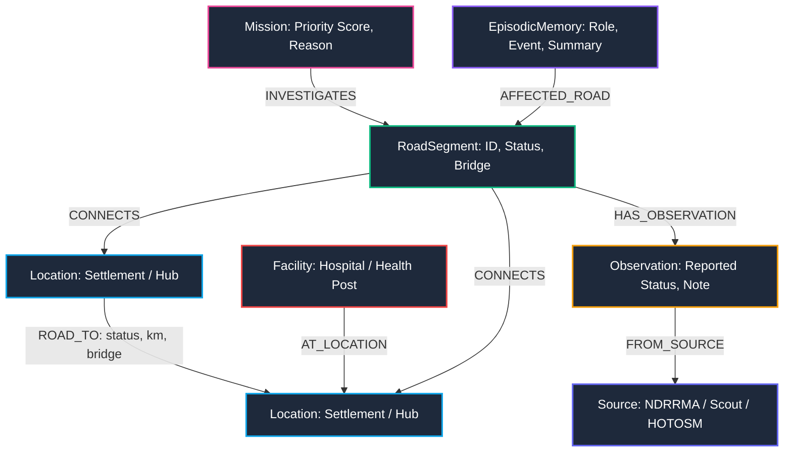

# Badi (बाढी) — Flood Response Route Intelligence

> WeMakeDevs × FalkorDB "Graph Hacks: Context for AI Agents" Hackathon
>
> Target Tracks:
> - Track 01: Agents That Act on Connected Data
> - Track 02: Agent Memory and Coordination

---

## Overview

In post-monsoon and glacial outburst floods across Nepal’s steep river valleys, mountain roads wash out within hours. Landslides cut off road links, bridges collapse, and entire villages lose access to emergency healthcare.

Disaster triage in this terrain is a graph connectivity problem for three reasons:

1. **Multi-hop path safety**: An unobserved road cannot be assumed safe. A route to a hospital has verified access only if every edge along the path has been physically confirmed passable.
2. **Topological cut-edge bottlenecks**: When a main road collapses, determining which unverified roads are the sole remaining lifelines for isolated settlements requires live multi-hop path traversals over connected graph topology.
3. **Episodic graph memory**: As scouts and coordinators inspect roads, log conflicting observations, or simulate landslides, these actions must persist as `(:EpisodicMemory)` nodes in FalkorDB so that autonomous agents track operations across sessions.

Badi runs flood reconnaissance directly on live FalkorDB graph topology. Every metric, road status, hospital route, mission rank, and memory record in the console comes from Cypher queries executed against the database.

---

## Hackathon Brief Requirements

| Brief requirement | How Badi implements it in FalkorDB | Live verification |
| :--- | :--- | :--- |
| **1. Follow connections across data** | Traverses multi-hop paths up to 7 hops across `(:Location)-[:ROAD_TO]->(:Location)`, surveyed bridge damage points `(:RoadSegment)-[:INCLUDES_BRIDGE]->(:Bridge)`, and health facilities `(:Facility)-[:AT_LOCATION]->(:Location)`. Identifies cut-edges where a single segment failure isolates downstream populations. | Preset: _Trace Syabrubesi Access_ and _Blast Radius_ |
| **2. Remember across sessions** | Writes queries, scout reports, landslide events, and triage choices to `(:EpisodicMemory)` nodes in FalkorDB with `session_id`, `agent_role`, `timestamp`, and `[:AFFECTED_ROAD]` relationships. | Preset: _Recall Graph Memories_ and Timeline tab |
| **3. Share state between agents** | Coordinates two agents: `Route Analyst` and `Field Coordinator`. When `Field Coordinator` updates road consensus or a landslide occurs, it mutates FalkorDB. `Route Analyst` queries the updated graph to recalculate hospital routes and re-rank the mission queue without cross-agent polling. | Dynamic re-ranking and _Landslide_ simulation button |
| **4. Connect people, projects, and decisions** | Connects people (`:Source` nodes: field scouts, emergency dispatchers) to decisions (`:Observation` consensus and `:EpisodicMemory` records) to projects (`:Mission` nodes) and physical network assets (`:RoadSegment` and `:Location`). | Preset: _Connect People, Projects & Decisions_ |
| **5. Show the path behind an answer** | Every agent response returns the exact multi-hop path followed, the live Cypher query executed against FalkorDB, supporting graph evidence, and the episodic memory node ID. | Chat UI: _Show Graph Path & Cypher Behind Answer_ drawer |

---

## FalkorDB Graph Schema



### Schema Nodes and Relationships

- `(:Location {id, name, type, district, lat, lon, households})`: Settlements, road junctions, and regional hubs.
- `(:Facility {id, name, location_id, type, importance_weight})`: District hospitals and health posts.
- `(:RoadSegment {id, name, u, v, length_km, is_bridge, status})`: Physical bidirectional roadway corridors.
- `(:Observation {id, road_id, status, note, timestamp, is_simulated})`: Ground reports from scouts and emergency bulletins.
- `(:Source {id, name, url, license})`: Data authorities (NDRRMA, HOTOSM, Scout Recon Unit).
- `(:Mission {id, road_id, priority_score, reason, sole_lifeline_count, total_dependent_count, status, timestamp})`: Dynamically prioritized reconnaissance targets.
- `(:EpisodicMemory {id, session_id, agent_role, event_type, summary, road_id, timestamp})`: Persistent coordination memory events.

---

## Epistemic Safety Rules and Consensus

Badi enforces three epistemic rules for ground reconnaissance:

1. **Default-to-unknown**: Unobserved roads never default to `verified_passable`. They initialize as `unknown`.
2. **Settlement access states**:
   - `VERIFIED_ACCESS`: At least one path where all edges are `verified_passable`.
   - `NEEDS_RECON`: Zero verified paths, but at least one potential path with `unknown` or `disputed` edges and zero `blocked` edges.
   - `ISOLATED_ON_MAP`: Zero verified paths and zero potential paths. All topological routes are cut by confirmed `blocked` segments.
3. **Consensus and dispute resolution**:
   - Only `blocked` observations produce `blocked`.
   - Only `verified_passable` observations produce `verified_passable`.
   - Conflicting reports produce `disputed` and trigger an immediate high-priority recon mission.
   - Ground scout reports (`src_scout`) with `override=True` resolve disputes.

---

## Core Cypher Queries

### 1. Verified Path to Healthcare Facilities

Finds loop-free paths up to 7 hops where every edge is confirmed passable:

```cypher
MATCH p = (s:Location {id: $settlement_id})-[:ROAD_TO*1..7]->(hub:Location)<-[:AT_LOCATION]-(f:Facility)
WHERE ALL(rel IN relationships(p) WHERE rel.status = 'verified_passable')
  AND ALL(n IN nodes(p) WHERE 1 = size([m IN nodes(p) WHERE m = n]))
RETURN p, f.id AS facility_id, f.name AS facility_name, f.importance_weight AS facility_weight
ORDER BY length(p) ASC
```

### 2. Potential Reconnaissance Paths

Finds unverified paths containing `unknown` or `disputed` edges without any confirmed `blocked` segments:

```cypher
MATCH p = (s:Location {id: $settlement_id})-[:ROAD_TO*1..7]->(hub:Location)<-[:AT_LOCATION]-(f:Facility)
WHERE NONE(rel IN relationships(p) WHERE rel.status = 'blocked')
  AND ANY(rel IN relationships(p) WHERE rel.status IN ['unknown', 'disputed'])
  AND ALL(n IN nodes(p) WHERE 1 = size([m IN nodes(p) WHERE m = n]))
RETURN p, f.id AS facility_id, f.name AS facility_name, f.importance_weight AS facility_weight
ORDER BY length(p) ASC
```

### 3. Downstream Topological Blast Radius

Finds all settlements that lose facility access if a given road segment fails:

```cypher
MATCH p = (s:Location {type: 'settlement'})-[:ROAD_TO*1..7]->(hub:Location)<-[:AT_LOCATION]-(f:Facility)
WHERE NONE(rel IN relationships(p) WHERE rel.status = 'blocked')
  AND ANY(rel IN relationships(p) WHERE rel.road_id = $road_id)
  AND ALL(n IN nodes(p) WHERE 1 = size([m IN nodes(p) WHERE m = n]))
RETURN DISTINCT s.id AS id, s.name AS name, s.households AS households, s.district AS district
```

### 4. Atomic Edge Synchronization

Updates the `RoadSegment` node and its bidirectional `[:ROAD_TO]` edges in a single transaction:

```cypher
MATCH (r:RoadSegment {id: $road_id})
SET r.status = $new_status
WITH r
OPTIONAL MATCH ()-[rel:ROAD_TO {road_id: $road_id}]->()
SET rel.status = $new_status
RETURN r.id AS road_id, r.status AS status
```

---

## Multi-Agent Architecture

Badi coordinates two specialized agents backed by FalkorDB tools:

- `Route Analyst`: Multi-hop path tracing, cut-edge bottleneck identification, and blast radius calculations.
- `Field Coordinator`: Mission queue ranking, scout dispatching, and dispute resolution.

### Offline Router and LLM Tool Calling

With a `GEMINI_API_KEY`, queries route through `gemini-3.1-flash-lite` with direct tool declarations. Without an API key, Badi falls back to a deterministic regex and keyword router that calls the same FalkorDB functions, so the system works fully offline.

### Hard Boundary Guardrails

When asked about casualties, deaths, or helicopter airlifts, Badi refuses the prompt with a boundary restriction:

> Boundary restriction: Badi evaluates mapped topological connectivity and recorded observations inside FalkorDB. It cannot verify physical terrain safety, casualties, or unmapped hazards.

---

## Quickstart Guide

### 1. Start FalkorDB

```bash
docker compose up -d
```

FalkorDB runs on `localhost:6379`. The FalkorDB browser UI is available at `localhost:3000`.

### 2. Install Dependencies

```bash
python3 -m venv .venv
source .venv/bin/activate
pip install -r requirements.txt
```

### 3. Seed the Graph

```bash
python -m scripts.seed_falkordb
```

### 4. Launch the Application

```bash
uvicorn backend.main:app --reload --host 0.0.0.0 --port 8000
```

Open `http://localhost:8000` to view the console.

### 5. Run the Tests

```bash
pytest -v
```

---

## Automated Test Suite

The test suite validates graph queries, consensus logic, and dynamic re-ranking:

```text
tests/test_cypher_queries.py::test_find_verified_paths_cypher PASSED
tests/test_cypher_queries.py::test_find_potential_paths_cypher PASSED
tests/test_cypher_queries.py::test_find_affected_settlements PASSED
tests/test_cypher_queries.py::test_get_road_evidence_chain PASSED
tests/test_cypher_queries.py::test_falkordb_removal_raises_503 PASSED
tests/test_epistemic_rules.py::test_unobserved_roads_never_verified_passable PASSED
tests/test_epistemic_rules.py::test_conflicting_observations_mark_road_as_disputed PASSED
tests/test_epistemic_rules.py::test_scout_override_resolves_dispute PASSED
tests/test_epistemic_rules.py::test_hard_guardrail_boundary_refusal PASSED
tests/test_falkordb_centrality.py::test_centrality_and_landslide_reranking PASSED
```

---

## FalkorDB Removal Test

FalkorDB is the sole database for Badi. There are no in-memory dictionary fallbacks or SQLite databases in the backend.

- If FalkorDB stops or becomes unreachable on `localhost:6379`, all API endpoints return `HTTP 503 Service Unavailable`.
- Automated test `tests/test_cypher_queries.py::test_falkordb_removal_raises_503` verifies this behavior.

---

## Project Disclosure

- **AI assistants used**: Antigravity (powered by Gemini Flash) was used as a pair programming assistant for schema drafting, Cypher query optimization, and test automation.
- **Original work**: The Bhote Koshi-Trishuli flood topological dataset, the epistemic safety state machine, the cut-edge bottleneck formulation, and the FalkorDB-grounded multi-agent orchestration were engineered specifically for this hackathon submission.
